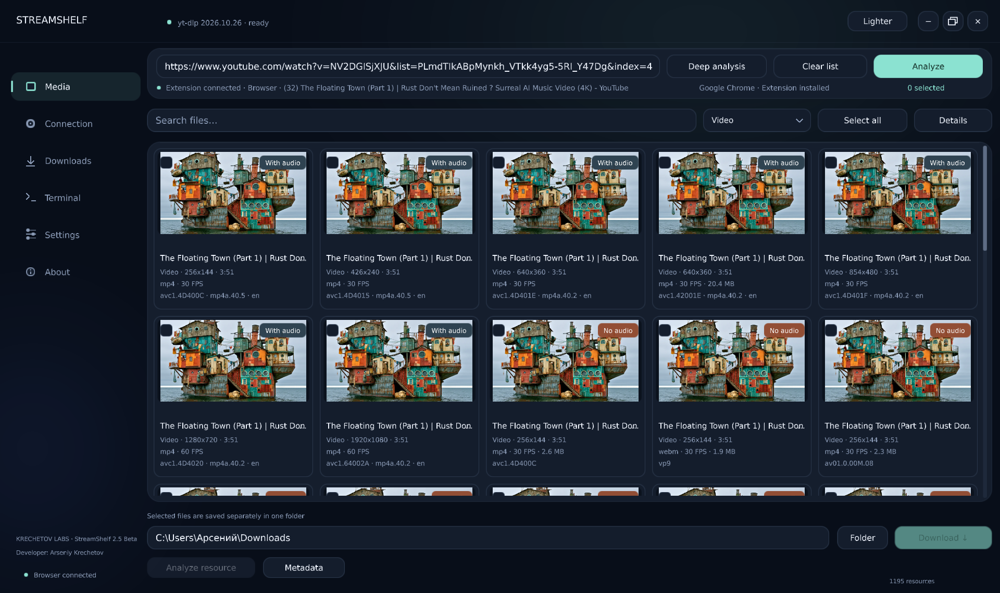
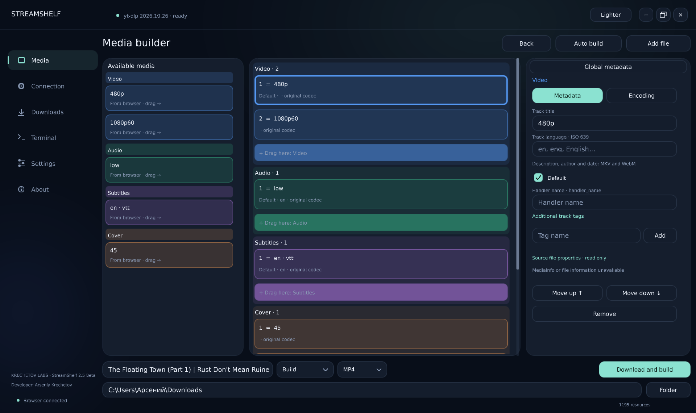
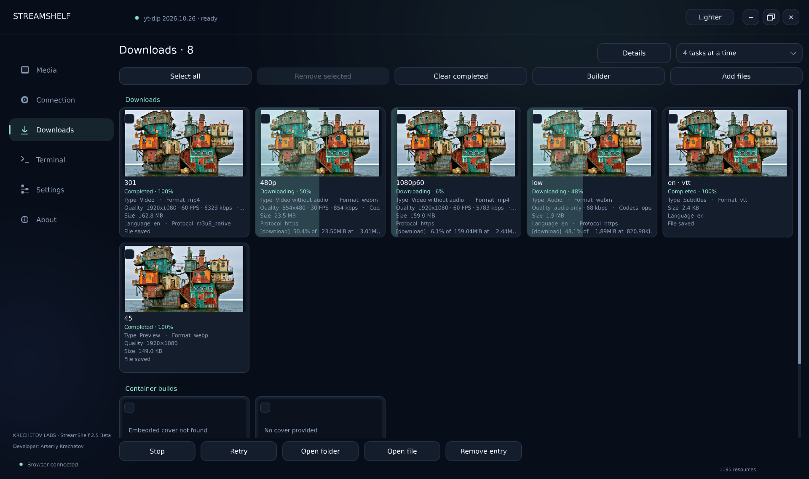

# StreamShelf

### English | [Русский](README_RU.md)

**Find, download, and assemble media on Windows.**

StreamShelf is a native Windows application for working with media from your browser and local files. The StreamShelf Connector extension connects the app to your active browser tab.

### [All releases](https://github.com/Econty/StreamShelf/releases) | [Русская инструкция](README_RU.md) | [Build guide (русский)](BUILDING.md)

**StreamShelf 2.5 Beta is in development and has not been published yet.** The latest published release is 2.4 Beta. The language features and English interface labels described below are planned for 2.5 Beta; 2.4 Beta uses a Russian interface.

## Features

- Analyze a web page and find available video, audio, subtitles, images, and supported streams.
- Download selected media or assemble tracks into a compatible container, with options for codecs, metadata, chapters, and cover art.
- Import local files into the media builder, inspect their tracks, and edit supported metadata. MediaInfo provides additional properties when available.
- Manage downloads, inspect a log, and install or update components from the app.
- Use StreamShelf Connector with Chrome, Yandex Browser, Firefox, and other compatible browsers. The guided setup covers Chrome, Yandex Browser, and Firefox; other browsers use manual setup.

Availability depends on the site, file, codecs, and container. StreamShelf does not bypass DRM.

## Languages

StreamShelf 2.5 Beta is being prepared with English and Russian support. On first launch, it selects Russian when the Windows display language is Russian and English otherwise. The language can be changed under **Settings → Language / Язык**.

The 1.0.4 extension being prepared for 2.5 Beta follows the app's language. When disconnected, it uses the browser's interface language, falling back to English for languages other than Russian.

**Русскоязычным пользователям:** [открыть полную инструкцию на русском](README_RU.md).

## Get started

The English interface labels below apply to the upcoming 2.5 Beta. For the published Russian-language release, see the [Russian instructions](README_RU.md).

1. Use Windows 10 or 11 x64 with an OpenGL 3.3-compatible graphics driver. If you downloaded an archive, extract it to a permanent folder and run `StreamShelf.exe`.
2. Open **Settings → Components** to check and install the tools you need: yt-dlp, FFmpeg, FFprobe, and Deno. These tools are managed in `%LOCALAPPDATA%\StreamShelfNative\tools`.
3. Open the connection page, select your browser, and start the extension setup. Follow the browser prompts to install and enable StreamShelf Connector. Firefox uses a signed XPI; Chrome and Yandex Browser load the unpacked Chromium extension.
4. Open StreamShelf Connector in the browser, select **Connect extension**, and review the requested website access. Open a page with media, return to StreamShelf, and select **Analyze**. Deep analysis can look for additional page resources; dynamic streams may require playback or a page reload.
5. Select media and a destination, then download it or open the builder to arrange tracks and adjust supported settings.

The extension requests broad website access to find page and media resources. Grant it only if you trust the extension. The [Russian extension setup guide](BROWSER-INSTALLER.md) covers the guided flow in more detail.

## Media builder

Add local files in Downloads or directly in the builder, then wait for the scan. You can choose the tracks, their order, supported metadata and encoding options, and a compatible output format. StreamShelf checks supported properties after assembly and keeps sources when it cannot safely preserve required data.

Not every file, tag, codec, or container combination is supported. One cover, one chapter source, and one global metadata source can be selected at a time; some programs and stream groups cannot be safely transferred.

## Screenshots

These screenshots show the Russian interface of an earlier version; the 2.5 Beta interface and labels may differ.

### Media overview



### Media builder



### Downloads



## Privacy and limitations

When needed for analysis or downloads, the extension sends cookies to the local application. Temporary copies are removed after the operation; cookie values should not appear in the ordinary log. A successful preview or metadata lookup does not guarantee that the complete file is accessible.

Sites with expiring links, browser-bound access, unusual authentication, or DRM may not work. Multiple profiles of the same browser and multi-monitor setups need further testing. Unfinished tasks need to be restarted after reopening the app and may require a new page analysis.

## Build from source

You need a C++20 compiler, Windows SDK, CMake 3.22 or newer, Ninja, and Node.js for the JavaScript tests. From the repository root:

```powershell
cmake --preset dev
cmake --build --preset dev --parallel
ctest --preset dev
```

For a release build, use the `release` preset. To include MediaInfo in the package, set `STREAMSHELF_MEDIAINFO_DLL` to a compatible signed DLL; otherwise the app looks for it separately. See the [detailed build guide in Russian](BUILDING.md), [Firefox signing notes](FIREFOX-SIGNING.md), and [third-party notices](THIRD_PARTY.md) (Russian).

## Support the project

**USDT (BEP-20)** — BNB Smart Chain:

`0x6C6Ac3ffD6fFC841e9445545073d9E0BB5E15Cb2`
