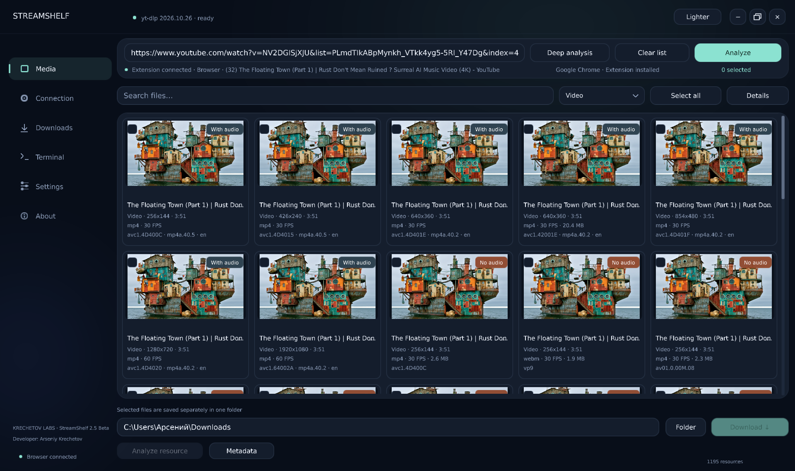
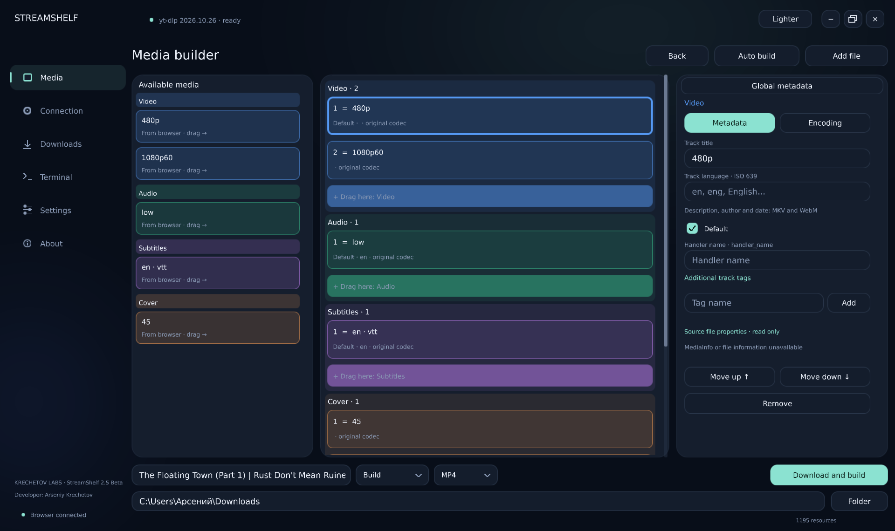
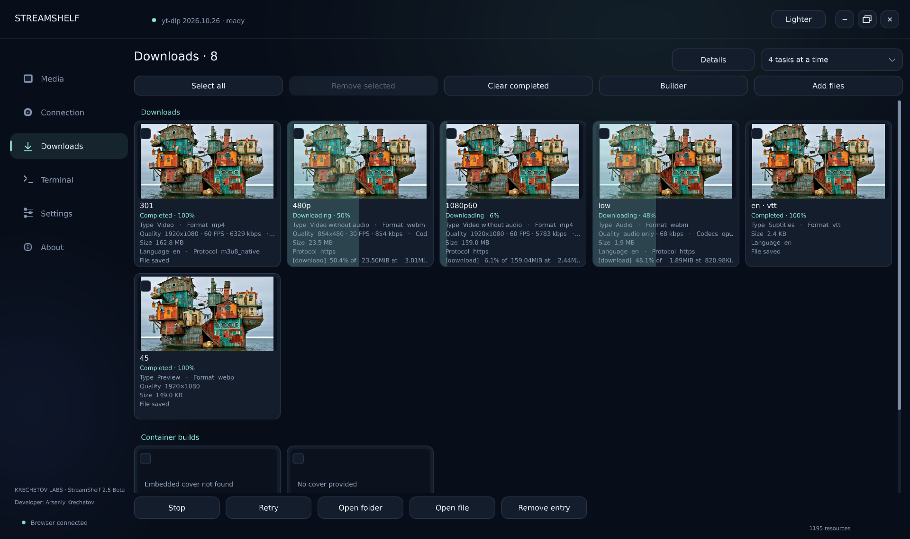

# StreamShelf

### [English](README.md) | Русский

**Анализируйте, скачивайте и собирайте медиа на Windows.**

StreamShelf — нативное приложение для работы с медиа из браузера и локальными файлами. Расширение StreamShelf Connector связывает его с активной вкладкой браузера.

### [Все релизы](https://github.com/Econty/StreamShelf/releases) | [Установка расширения](BROWSER-INSTALLER.md) | [Сборка](BUILDING.md)

**StreamShelf 2.5 Beta** доступен на [странице релизов](https://github.com/Econty/StreamShelf/releases). Установщик пока не имеет цифровой подписи.

В 2.5 Beta доступны русский и английский интерфейсы. При первом запуске программа выбирает русский для русского языка интерфейса Windows и английский в остальных случаях. Переключить язык можно в настройках: **Language / Язык**. Расширение 1.0.4 следует языку программы, а без подключения выбирает язык браузера.

Нужны Windows 10/11 x64 и драйвер с поддержкой OpenGL 3.3. Если скачан архив, полностью распакуйте его в постоянную папку и запустите `StreamShelf.exe`. Для работы с медиа установите нужные компоненты в разделе **Настройки → Компоненты**.

## Скриншоты

На изображениях показан русский интерфейс; внешний вид и подписи могут отличаться от текущей версии.

### Обзор медиа

Выбор доступных форматов и качества перед загрузкой.

### Конструктор медиа

Сборка дорожек и настройка метаданных в одном окне.

### Загрузки

Отслеживание загрузок и собранных файлов.

## Поддержать проект

**USDT (BEP-20)**

`0x6C6Ac3ffD6fFC841e9445545073d9E0BB5E15Cb2`

Сеть перевода — BNB Smart Chain (BEP-20).

## Возможности конструктора

Универсальный конструктор позволяет собирать и отдельно сохранять медиа, выбирать дорожки, кодеки и совместимый контейнер. При импорте локальных файлов он обнаруживает поддерживаемые дорожки, обложку, главы, метаданные и вложения; встроенные обложки отображаются в карточках загрузок. В конструктор добавлены подробные сведения MediaInfo и расширенное редактирование тегов. Обновлены мастера установки и повторного подключения расширений в Chrome, Яндекс Браузере и Firefox.

## Конструктор и метаданные

Добавьте файлы в «Загрузки», выберите их и откройте конструктор, либо добавьте файл непосредственно в конструкторе. Дождитесь анализа; «Автосборка» раскладывает обнаруженные источники по категориям. Вы можете изменить состав, порядок, метаданные и настройки кодирования, выбрать совместимый формат и папку сохранения.

При сохранении программа проверяет доступные характеристики и предупреждает, если выбранный контейнер не сохранил обнаруженные данные. Разбор и сохранение зависят от возможностей FFprobe и FFmpeg; поддержка всех существующих файлов и сочетаний форматов не гарантируется. Сейчас одновременно выбирается одна обложка, один источник глав и один источник общих метаданных. Некоторые программы и группы потоков нельзя безопасно перенести: исходный файл сохраняется, а сборка останавливается с сообщением.

Библиотека MediaInfo позволяет просматривать подробные свойства, если она доступна в комплекте или установлена отдельно. Часть характеристик определяется содержимым файла и доступна только для чтения; поля метаданных редактируются в конструкторе, а параметры кодирования — во вкладке «Кодирование».

## Инструменты

В разделе «Настройки → Компоненты» можно проверить установленные и доступные версии yt-dlp, FFmpeg, FFprobe и Deno и установить недостающие или устаревшие компоненты. Используемые программой файлы находятся в `%LOCALAPPDATA%\StreamShelfNative\tools`; кнопка «Папка компонентов» открывает именно этот каталог. При удалении файлов из него состояние обновляется автоматически. Удалённые компоненты не восстанавливаются при запуске без действия пользователя.

Загрузка yt-dlp и Deno выполняется с GitHub соответствующих проектов; FFmpeg и FFprobe поставляются парой из сборки gyan.dev. Скачанные архивы и файлы проверяются по опубликованным SHA-256 и запускаются для проверки версии. Во время скачивания отображаются прогресс и объём полученных данных. Автоматическую проверку установленного yt-dlp при запуске можно выключить в настройках. Программа не использует копии из `bundled-tools` или системного PATH для определения установленных компонентов.

В терминале команда `/versions` показывает локальные версии всех четырёх компонентов, а `/help` — доступные команды. Команды также можно запускать по отдельности: `yt-dlp --version`, `ffmpeg -version`, `ffprobe -version`, `deno --version`.

## Подключение и анализ

1. Мастер установки расширения работает только в Яндекс Браузере, Mozilla Firefox и Google Chrome. Выберите браузер и запустите «Установить с подсказками». В Яндекс Браузере и Chrome мастер проведёт через загрузку распакованного расширения, а в Firefox — через установку подписанного XPI. В остальных браузерах установите расширение вручную.
2. Откройте StreamShelf Connector в меню расширений, нажмите «Подключить расширение» и самостоятельно подтвердите запрос доступа браузера. Разрешение «на всех сайтах» широкое: оно позволяет расширению получать доступ к сайтам и связано с анализом страниц и медиаресурсов. Подтверждайте его только если доверяете расширению. Настройки доступа можно изменить в браузере. После подключения откройте страницу с медиа: активная вкладка определяется автоматически.
3. Откройте страницу с медиа и вернитесь в StreamShelf. В обзоре проверьте название и адрес и нажмите «Анализировать». «Глубокий анализ» дополнительно ищет данные страницы через расширение; для динамических потоков может потребоваться начать воспроизведение или обновить страницу.
4. Выберите медиа, папку и нажмите «Скачать». Дополнительные форматы доступны в «Подробностях». Папка сохранения запоминается. «Очистить список» удаляет результаты анализа, но не скачанные файлы; в настройках можно включить сохранение предыдущих результатов.

Закрепление значка в панели браузера необязательно. Для проверки подключения используется ответ расширения через Native Messaging, а не только наличие его карточки. Сценарий установки и ограничения описаны в `BROWSER-INSTALLER.md`, сведения о проверках — в `VERIFICATION.md`.

## Приватность и ограничения

Cookies передаются локально по запросу для анализа и скачивания, временные копии удаляются после операции. Обычный журнал не должен содержать значения cookies. Сайты с истёкшими ссылками, привязкой доступа к браузеру, нестандартной авторизацией или DRM могут не поддерживаться; DRM не обходится. Успешное превью или получение метаданных не гарантирует доступность всего файла.

Работа в разных профилях одного и того же браузера и многомониторная конфигурация ещё требуют проверки; определение браузера по исполняемому файлу само по себе не отличает профили. Незавершённые задачи после перезапуска требуют повторного запуска. Запросу на скачивание могут понадобиться новые данные вкладки и повторный анализ.

## Сборка

Для Windows-сборки необходимы компилятор C++20, Windows SDK, CMake и Ninja. Для включения MediaInfo в установочный комплект задайте путь к подписанной библиотеке параметром CMake `STREAMSHELF_MEDIAINFO_DLL`; без него приложение ищет MediaInfo отдельно. Порядок настройки, сборки, тестирования и упаковки описан в [BUILDING.md](BUILDING.md). Исходники не содержат .NET-проекта. Инструменты yt-dlp, FFmpeg/FFprobe и Deno для поставки подготавливаются отдельно.

Подробнее: [условия сторонних компонентов](THIRD_PARTY.md) · [подпись расширения Firefox](FIREFOX-SIGNING.md) (на английском).
